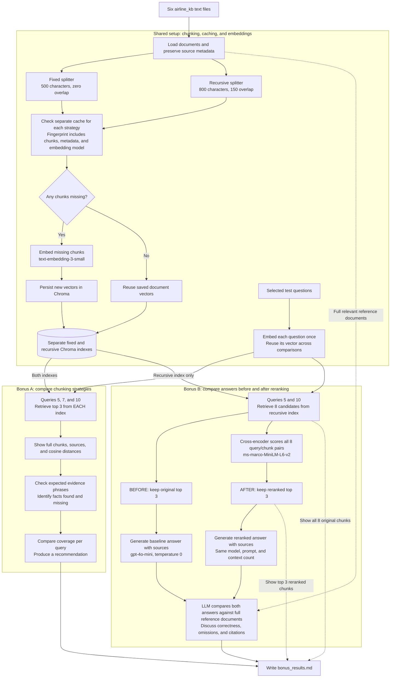

# How `bonus.py` works

This diagram shows the default run, `python bonus.py`, which executes both bonuses.

- **Caching:** saved document vectors are reused; selected questions still need embeddings on each run.
- **Fair answer comparison:** both Bonus B answers receive three chunks selected from the same eight candidates. Reranking changes which chunks are selected and their order.
- **Evaluation:** Bonus A uses a source-specific phrase checklist; Bonus B uses LLM-assisted feedback. These are diagnostics, not guaranteed correctness scores. Lower cosine distance is better; higher cross-encoder score is better.
- **Chunk sizes:** both strategies here measure characters. The fixed splitter's default paragraph separator can produce chunks longer than its 500-character target.
- **Run options:** `--part a` runs only Bonus A; `--part b` runs only Bonus B using the recursive index; `--check` stops after local loading and chunking without API calls.
