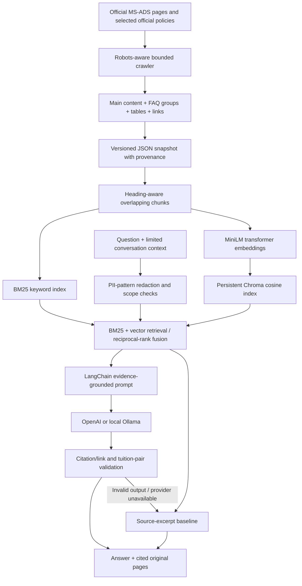

# MS-ADS Program Guide — Streamlit RAG app

An unofficial, source-cited assistant for the University of Chicago's MS in Applied Data Science program. The runnable application is in `app/`. The supplied project brief and assignment guidance are kept at the top level.

## Start locally

From this course workspace, using the existing environment:

```bash
cd 'Midterm Project/app'
../../.venv/bin/python -m streamlit run streamlit_app.py
```

Open **http://localhost:8501**. Run from the app folder so Streamlit uses the included theme and secrets configuration.

For a fresh machine, use Python 3.12:

```bash
cd 'Midterm Project/app'
python3.12 -m venv .venv
source .venv/bin/activate
python -m pip install -r requirements.txt
python -m rag.prepare --download-model
python -m streamlit run streamlit_app.py
```

The `requirements.txt` **inside `app/`** is the Python dependency file. The supplied assignment guidance is saved as `Midterm Project/deliverables.txt`; it is prose and cannot be passed to pip.

The saved official corpus is included, so crawling is not required to try the app. The semantic model downloads once when preparing the index. Without a semantic model, the interface clearly labels its BM25-only retrieval mode and remains usable.

## Answer modes

- **Source excerpts:** displays relevant quoted passages with source links. No generative model or API key is needed. This is a retrieval baseline, not an LLM-generated answer.
- **Ollama:** uses a model installed on the same machine as the Streamlit server. The interface discovers models through `http://127.0.0.1:11434/api/tags`. An existing `gemma4:latest` model was found on the development machine. Start Ollama before launching the app; select the model in Answer settings. Hardware and model choice substantially affect latency. Ollama on your laptop is not automatically accessible to a cloud-hosted Streamlit server.
- **OpenAI:** enter a key in the password field for the current browser session, or configure `OPENAI_API_KEY` through environment variables, `app/.env`, or Streamlit secrets. The model field defaults to `gpt-4.1-mini` and is configurable. The redacted question, recent redacted conversation and retrieved public text are sent to OpenAI. Model access depends on the configured API account.

The interface chooses OpenAI if a server key exists, otherwise an available local Ollama model, otherwise source excerpts. Changing the provider does not rebuild the retrieval index. Failed model calls or malformed/invalidly cited answers fall back to clearly labeled source excerpts.

## Interface

1. **Ask the guide:** example questions, a conversational chat, follow-up context, inline citations, expandable retrieved passages, latency and actual answer-mode labels, conversation reset and a JSON download.
2. **Source library:** inspect every saved official page and extracted section; see snapshot dates and crawl notices.
3. **Evaluation:** run the supplied twelve questions, four additional validation/scope checks, or both. Optional answer generation uses the selected provider. Export the complete report with source ranks and references.

The app does not save chat logs to disk. Chat state and user-entered API keys are held in the current Streamlit session. The download contains only the redacted conversation and answer details, never API keys.

## Architecture



### Data collection and preprocessing

The crawler starts at the program URL specified in the PDF. It follows only the program's own subtree and explicitly allowed redirected program, tuition, English-policy, fee-policy and Booth joint-degree pages. It rejects unrelated hosts, non-HTTP URLs, credentials in URLs and binary assets. It reads robots.txt, bounds the crawl, applies request timeouts and delays, and records failures rather than inventing missing content.

Page extraction removes navigation, sidebars, scripts, forms, footers and related-news blocks. Nested FAQ questions retain their parent category, so MBA/MS requirements remain distinguishable from standalone MS-ADS requirements. Paragraphs, ordinary list items, table rows, meaningful hyperlinks and address blocks are preserved. Repeated commas within numeric values are normalized. The site's slash-separated tuition amounts are relabeled using their existing course-count labels; no amounts are supplied by the application.

`data/corpus.json` records URLs, titles, section headings, content hashes, collection time and crawl notices. The original HTML from this machine's crawl is in the ignored `.cache/raw/` directory. Only official website content enters retrieval: neither the assignment PDF nor its example answers are indexed.

The current snapshot contains **16 official pages**. One events/deadlines page had no extractable main-page body; its collection notice is visible in the source library. Application deadlines are available from the How to Apply page.

### Chunking, embeddings and vector storage

Sections are split with LangChain's `RecursiveCharacterTextSplitter`, using an 850-character budget and 120-character overlap. A chunk never crosses section boundaries. Each chunk has a deterministic ID, URL, page title, heading and collection date. The small chunk size usually fits the embedding model's 256-token window; unusually token-dense text can still be truncated by the tokenizer. A future improvement is exact tokenizer-aware chunking.

`sentence-transformers/all-MiniLM-L6-v2` produces normalized 384-dimensional vectors locally. Chroma persists them in `app/.cache/chroma/` with cosine distance. Its collection name includes a hash of the chunk IDs and model configuration, so a changed snapshot does not silently reuse stale vectors. Missing entries are upserted; repeated setup reuses existing entries. User chat history and credentials are never stored in the shared vector index.

BM25 ranks terms using document frequency, term-frequency saturation and document-length normalization. General vocabulary expansions improve matching for admissions concepts. Keyword and semantic candidates are combined with reciprocal-rank fusion using a constant of 60. Queries for the standalone MS program de-prioritize MBA/MS and PhD sections unless the question explicitly requests those programs. Similarity and rank scores are shown as retrieval diagnostics, not confidence percentages.

### Generation and conversation

LangChain's `ChatPromptTemplate` separates the system instructions from the evidence and conversation. OpenAI uses `ChatOpenAI`; Ollama uses its documented local chat endpoint. The prompt requires JSON containing a Markdown answer and an insufficient-evidence flag, with factual paragraphs citing numbered retrieved sources. It requests format/year distinctions and explicit uncertainty for incomplete or conflicting evidence.

Only the last six redacted conversation messages are passed into generation, with length limits. A short follow-up such as “What about online?” includes the previous user question in the retrieval query. Independent questions do not automatically inherit the prior topic. The index and embedding model are cached as shared read-only search resources; chats and keys stay in separate sessions.

The answer validator rejects nonexistent citation IDs, uncited non-abstention answers and links absent from the retrieved evidence. It also checks clearly labeled course-count/tuition-amount claims against the corresponding source pairs. This check was added after a real local-model test swapped two pathway totals. These checks reduce particular failure modes; they do **not** prove that every sentence is supported. Review source passages for important decisions.

### Responsible behavior and limitations

The bot is limited to program information. Obvious attempts to override its instructions are declined. Retrieved pages are treated as evidence, not instructions. Scope checks and evidence thresholds produce an admissions referral for unsupported questions. These heuristic checks are useful but are not a formal guarantee against all prompt injection or off-topic requests.

Regular expressions remove email addresses, common North American phone-number formats and SSN-shaped strings from user questions and conversation before model calls. This is limited pattern-based redaction: it does not detect every name, address, identifier or international phone format. Public contact details in the official corpus remain available as evidence. Ask users not to submit application records or sensitive personal information.

The app answers from a dated snapshot. It does not browse on each question, grant waivers, process admissions applications or guarantee visa/OPT eligibility. Cohort and format differences matter. The provided examples contain older details; current official sources and snapshot-checked evaluation references take precedence. A generated answer must distinguish prior and current requirements rather than combine them.

## Refresh sources and rebuild

From `app/` with the Python environment activated:

```bash
python -m rag.ingest --max-pages 28
python -m rag.prepare --download-model
```

A crawl with fewer than four successfully extracted pages does not replace an existing corpus. Review collection notices after refresh. Clear source dates and process-level cache keys make changes visible to app sessions. Old Chroma collections remain in the ignored cache for audit/reuse; remove `.cache/chroma/` while the app is stopped if you want a clean rebuild.

## Tests and evaluation

```bash
python -m unittest discover -s tests -v
python -m rag.evaluation --output data/evaluation_report.json
python -m rag.evaluation --keyword-only --output data/keyword_evaluation_report.json
python -m rag.evaluation --generate --provider Ollama --model gemma4:latest --output data/ollama_evaluation_report.json
```

The verified build passed all 15 automated tests and Streamlit AppTest flows for initial render, cited chat, source browsing and evaluation. A headless-browser check passed on desktop and a 390-pixel mobile viewport with no JavaScript errors or page overflow. QA screenshots are included in `app/data/qa/`.

`app/data/evaluation_report.json` records Hit@6 = 1.00 and MRR@6 = 0.85 across 15 answerable cases in this snapshot. These are small-set retrieval results, not a response-accuracy claim. `app/data/ollama_smoke_report.json` records three successful local-model checks (tuition, online visa sponsorship and English requirements), with observed latencies of approximately 26–69 seconds. OpenAI generation was not called because no API key was configured. Exact locally tested library versions are recorded in `app/data/tested_versions.json`.

The automated tests cover URL restrictions, nested FAQ extraction, address/table preservation, noise removal, source provenance, chunk boundaries, empty retrieval, scope refusal, current versus joint-degree requirements, credential-free fallback, mock generation, invalid citations, tuition-pair swaps, privacy patterns, follow-up context and metric semantics.

`data/evaluation_set.json` has twelve provided development examples plus independently worded validation and scope questions. Each answerable case has curated relevant **URL and section-heading** labels, a snapshot-checked reference and reference-term groups. The evaluation files are separate from ingestion, so these answers do not leak into the knowledge base. These validation questions are an additional check, not an independently administered benchmark or a claim of generalization.

- **Hit@k:** fraction of answerable cases with at least one labeled relevant passage in the top k.
- **MRR@k:** mean reciprocal rank of the first labeled relevant passage; zero if no relevant passage is retrieved.
- **Latency:** measured wall time for retrieval and, when requested, generation.
- **Reference-term coverage:** optional fraction of reference groups matched in the answer. It is a coarse lexical proxy, not factual accuracy, semantic relevance or an LLM-judge score.
- **Scope cases:** shown separately and excluded from answerable retrieval-metric denominators. With answer generation enabled, inspect their abstention outcomes.

For a meaningful response assessment, have a reviewer score each generated answer using this rubric:

| Dimension | 0 | 1 | 2 |
|---|---|---|---|
| Correctness | Incorrect or unsupported | Mostly correct, material qualification missing | Correct against saved sources |
| Completeness | Misses the question | Answers partly | Covers all requested parts |
| Citation support | Missing or misleading | Mixed support | Every factual claim traceable |
| Format / year | Mixes programs or years | Ambiguous scope | Clearly distinguishes relevant format and cycle |
| Abstention | Invents an unsupported answer | Partial uncertainty | Appropriately states limits and refers onward |

Store reviewer scores separately from retrieval metrics. Do not present keyword coverage or source-ID validity as a hallucination rate. After refreshing the corpus, re-check gold references and relevance labels before comparing scores.

## Deploy for staff evaluation

A public deployment has not been published by this build. The local URL works only while the server is running on your computer. To obtain the shareable URL requested by the assignment:

1. Add the `app/` contents to a GitHub repository, including `data/corpus.json`, `data/evaluation_set.json`, and the installable `requirements.txt`. Exclude `.env`, real secrets, `.cache`, environments and chat exports. Alternatively deploy this repository using the entrypoint `Midterm Project/app/streamlit_app.py`; its neighboring dependency file takes precedence over any top-level assignment file.
2. Create a Streamlit Community Cloud app, choose Python 3.12 and select the correct entrypoint.
3. Add a server-owned `OPENAI_API_KEY` in the deployment's secrets UI for staff to receive generated answers without supplying a key. Optionally set `OPENAI_MODEL`.
4. For automatic semantic setup on a new host, add `ALLOW_MODEL_DOWNLOAD = "1"` to Streamlit secrets or set the environment variable. This downloads the embedding model and builds the vector index on the first resource load; allow for its memory/download cost. With no download permission/cache, the app visibly uses keyword-only retrieval. The local development cache is deliberately not committed.
5. Open the deployed URL, test the sample questions, verify that semantic retrieval is active when intended, and provide that URL for the staff evaluation period.

Choose a host with enough memory for PyTorch, MiniLM, Chroma and the Streamlit process. A local Ollama model requires a separate suitable server and is not configured as a public arbitrary endpoint in this app.

The assignment guidance also calls for the team's presentation and recording. The app's architecture, source library, exported evaluation report and this README provide material for that presentation.

## File map

```text
Midterm Project/
├── Class project-1 Midterm Project-1.pdf  # supplied brief, preserved
├── deliverables.txt                    # supplied assignment guidance
├── README.md
└── app/
    ├── streamlit_app.py
    ├── requirements.txt                # installable Python dependencies
    ├── .env.example
    ├── .streamlit/config.toml
    ├── .streamlit/secrets.toml.example
    ├── rag/
    │   ├── ingest.py
    │   ├── retrieval.py
    │   ├── engine.py
    │   ├── evaluation.py
    │   └── prepare.py
    ├── data/
    │   ├── corpus.json
    │   ├── evaluation_set.json
    │   └── evaluation_report.json
    └── tests/test_rag.py
```

## Implementation references

- [Official MS-ADS source site](https://datascience.uchicago.edu/education/masters-programs/ms-in-applied-data-science/)
- [Streamlit chat input](https://docs.streamlit.io/develop/api-reference/chat/st.chat_input)
- [Streamlit secrets](https://docs.streamlit.io/develop/concepts/connections/secrets-management)
- [Streamlit deployment dependencies and entrypoint precedence](https://docs.streamlit.io/deploy/streamlit-community-cloud/deploy-your-app/app-dependencies)
- [LangChain ChatOpenAI](https://docs.langchain.com/oss/python/integrations/chat/openai)
- [Official OpenAI API quickstart](https://developers.openai.com/api/docs/quickstart)
- [MiniLM embedding model card](https://huggingface.co/sentence-transformers/all-MiniLM-L6-v2)
- [Chroma embedding interfaces](https://docs.trychroma.com/docs/embeddings/embedding-functions)
- [Ollama chat endpoint](https://docs.ollama.com/api/chat)
